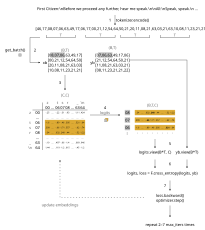

# Jules Gpt

Programming ChatGPT2 from scratch, by hand, without AI.

## Repository Layout

- input.txt: all works of shakespeare concatenated into one text file
- tokenizer.py: character based encoding

## Illustrations

Here I put a couple of illustrations of important concepts that are relevant to the transformer architecture.

### Bigram Model Training Loop

1) the input is encoded with the tokenizer
2) get a (B,T) batch of the encoded text; an xb batch that we predict on and a yb batch with the correct results (shifted right by one)
3) for each (B,T) value the embedding is looked up
4) the result is a (B,T,C) tensor
5) reshape to (B*T,C) tensor (for the next step)
6) compute the negative log likelihood (cross entropy) with our predictions (logits) against the yb batch
7) backpropagation which updates the embeddings
